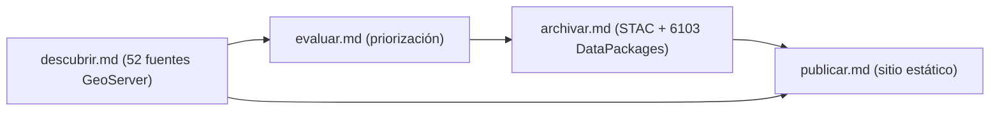

# Geodatos Bolivia

Repositorio que mantiene un índice vivo de capas geográficas públicas de Bolivia (instancias GeoServer) y preserva datasets vectoriales en Archive.org como GeoParquet y PMTiles, publicados bajo STAC 1.1.0 y Frictionless DataPackage.

## Descubrimiento en Protocolo OKF / DataMesh

- **Catálogo federado (`llms.txt`)**: [llms.txt](llms.txt)
- **Catálogo raíz STAC 1.1.0**: [archivar/catalog.json](../archivar/catalog.json)
- **Directorio de fuentes GeoServer**: [descubrir/directorio.json](../descubrir/directorio.json)
- **Registro cronológico (ledger)**: [log.md](log.md)

## Mapa del Grafo de Módulos

| Concepto | Tipo | Propósito |
| :--- | :--- | :--- |
| [descubrir.md](descubrir.md) | `operations` | Monitoreo de instancias GeoServer e inventario histórico de capas |
| [evaluar.md](evaluar.md) | `operations` | Estimación, priorización y preparación de datasets candidatos |
| [archivar.md](archivar.md) | `infrastructure` | Preservación vectorial (GeoParquet, PMTiles), STAC 1.1.0 y DataPackages |
| [publicar.md](publicar.md) | `operations` | Construcción y publicación del sitio estático en GitHub Pages |
